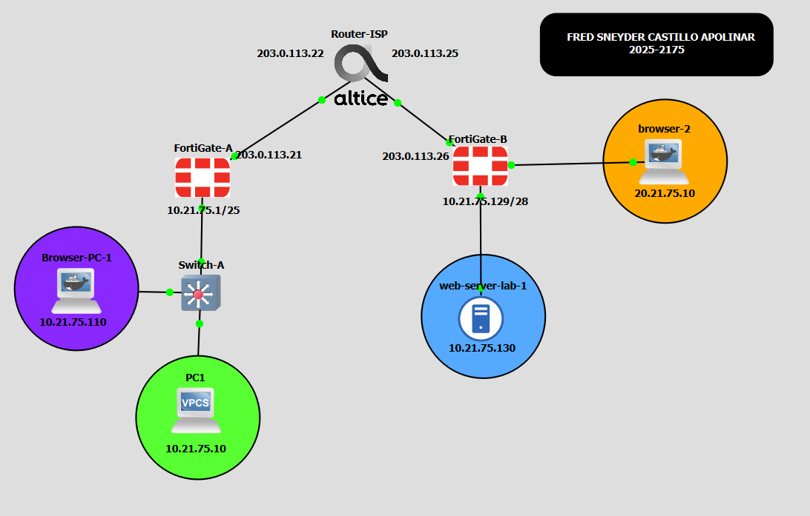
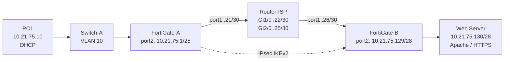
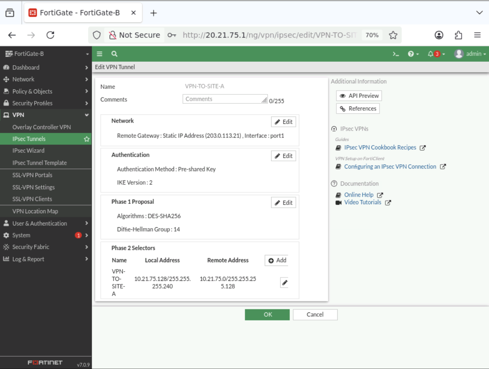
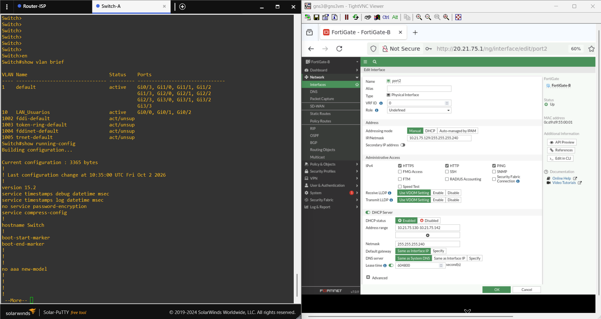
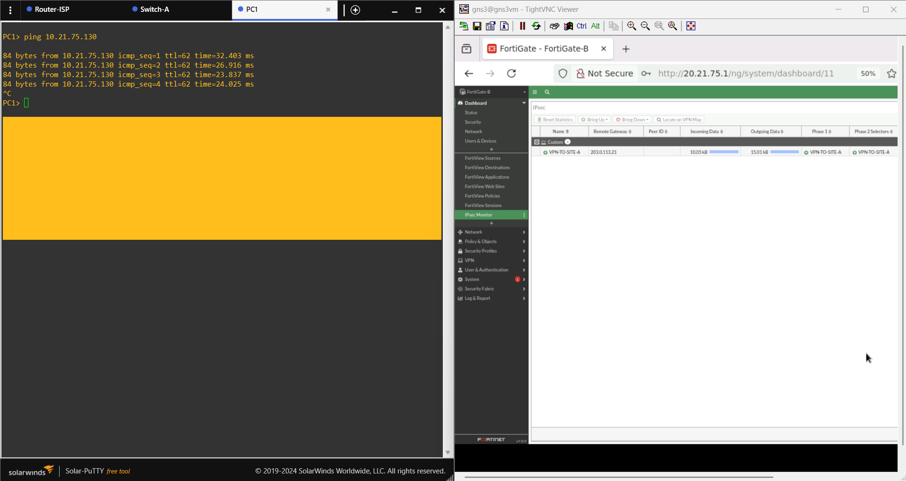
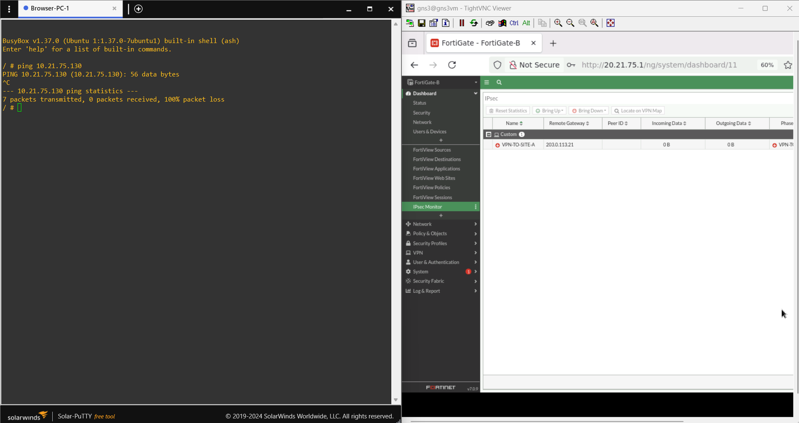
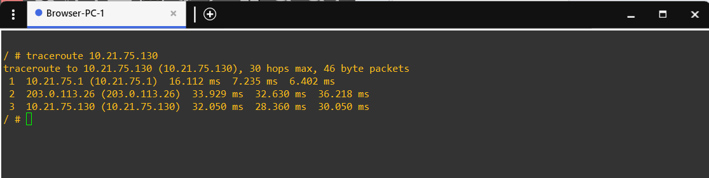

<h1 align="center">🔐 FortiGate Site-to-Site IPsec VPN</h1>

<p align="center">
  <a href="https://github.com/fredcastillo/fortigate-site-to-site-vpn"></a>
  <a href="https://github.com/fredcastillo/fortigate-site-to-site-vpn"></a>
  <a href="https://github.com/fredcastillo/fortigate-site-to-site-vpn"></a>
  <a href="https://github.com/fredcastillo/fortigate-site-to-site-vpn"></a>
  <a href="https://github.com/fredcastillo/fortigate-site-to-site-vpn"></a>
  <a href="https://github.com/fredcastillo/fortigate-site-to-site-vpn"></a>
</p>

<p align="center">
  
> **Network Security · GNS3 · FortiOS v7.0.9** | **Student:** Fred Sneyder Castillo Apolinar | **Student ID:** 2025-2175 |

</p>

## 🎥 Demonstration Video

<div align="center">
  <a href="https://www.youtube.com/watch?v=bi5LRA3CluY">
    
  </a>
</div>

---

## 📌 Lab Overview

This lab implements secure communication between two private networks located at different sites through a **Site-to-Site IPsec VPN** between two FortiGate firewalls.

The infrastructure represents:

- **Site A:** user network `10.21.75.0/25`.
- **Site B:** server network `10.21.75.128/28`.
- **WAN transit:** two `/30` links simulated through an ISP router.
- **Remote service:** an HTTPS web server located at Site B.

The functional goal of this lab is to allow a user at Site A to communicate with the server at Site B **through the VPN connection**, and to demonstrate that this communication stops working when the tunnel is not active.

---

## Objectives

### Main Objective

Establish and validate a Site-to-Site IPsec tunnel between FortiGate-A and FortiGate-B to transport traffic between the user network and the server network without performing NAT on VPN traffic.

### Specific Objectives

- Configure IP addressing on the FortiGate firewalls.
- Configure WAN connectivity through the ISP router.
- Configure VLAN 10 for the user network.
- Enable DHCP for the Site A LAN.
- Configure NAT for Internet access.
- Configure the HTTPS web server at Site B.
- Create the IPsec tunnel using **Custom** mode.
- Configure the Phase 2 traffic selectors.
- Configure static routes to the remote LAN.
- Create bidirectional LAN ↔ VPN firewall policies.
- Verify User → Web Server connectivity.
- Run a traceroute to the server.
- Demonstrate how connectivity depends on the VPN tunnel's state.

---

## 🗺️ Topology



The actual topology was implemented in GNS3. The **Browser-PC** nodes are auxiliary devices used to access the FortiGate GUI for administration; they are not part of the infrastructure's main functional traffic flow.



> **Diagram:** the actual GNS3 topology screenshot is included as evidence; the Mermaid diagram complements the technical documentation in this repository.

---

## 🌐 IP Addressing

| Device | Interface | Address | Function |
|---|---|---:|---|
| FortiGate-A | `port1` | `203.0.113.21/30` | WAN / ISP transit |
| ISP Router | `GigabitEthernet1/0` | `203.0.113.22/30` | Transit to Site A |
| ISP Router | `GigabitEthernet2/0` | `203.0.113.25/30` | Transit to Site B |
| FortiGate-B | `port1` | `203.0.113.26/30` | WAN / ISP transit |
| FortiGate-A | `port2` | `10.21.75.1/25` | User LAN gateway |
| PC1 | LAN | `10.21.75.10` | User / DHCP |
| FortiGate-B | `port2` | `10.21.75.129/28` | Server LAN gateway |
| Web Server | LAN | `10.21.75.130/28` | HTTPS server |

### Networks

- **User LAN:** `10.21.75.0/25` (`255.255.255.128`)
- **Server LAN:** `10.21.75.128/28` (`255.255.255.240`)
- **WAN A:** `203.0.113.20/30`
- **WAN B:** `203.0.113.24/30`

---

## 🔐 IPsec VPN Design

### FortiGate-A → Site B

| Parameter | Value |
|---|---|
| Name | `VPN-TO-SITE-B` |
| Mode | Custom |
| Interface | `port1` |
| Remote Gateway | `203.0.113.26` |
| IKE | v2 |
| Authentication | Pre-Shared Key |
| Phase 1 Proposal | `DES-SHA256` |
| DH Group | `14` |
| Local Selector | `10.21.75.0/25` |
| Remote Selector | `10.21.75.128/28` |
| Phase 2 Proposal | `DES-SHA256` |

### FortiGate-B → Site A

| Parameter | Value |
|---|---|
| Name | `VPN-TO-SITE-A` |
| Mode | Custom |
| Interface | `port1` |
| Remote Gateway | `203.0.113.21` |
| IKE | v2 |
| Authentication | Pre-Shared Key |
| Phase 1 Proposal | `DES-SHA256` |
| DH Group | `14` |
| Local Selector | `10.21.75.128/28` |
| Remote Selector | `10.21.75.0/25` |
| Phase 2 Proposal | `DES-SHA256` |




---

## 🛣️ Routing

### FortiGate-A

- Default route: `0.0.0.0/0` → gateway `203.0.113.22` through `port1`.
- Remote route: `10.21.75.128/28` through `VPN-TO-SITE-B`.

### FortiGate-B

- Default route: `0.0.0.0/0` → gateway `203.0.113.25` through `port1`.
- Remote route: `10.21.75.0/25` through `VPN-TO-SITE-A`.

The ISP router does not require additional static routes for these two WAN networks because both are directly connected to the router.

---

## 🛡️ Firewall Policies and NAT

### FortiGate-A

| Policy | Incoming | Outgoing | Source | Destination | NAT |
|---|---|---|---|---|---|
| `LAN -> VPN` | `port2` | `VPN-TO-SITE-B` | `LAN_USUARIOS` | `LAN_SERVIDOR` | Disabled |
| `VPN -> LAN` | `VPN-TO-SITE-B` | `port2` | `LAN_SERVIDOR` | `LAN_USUARIOS` | Disabled |
| `USUARIOS_A_INTERNET` | `port2` | `port1` | `LAN_USUARIOS` | `all` | Enabled |

### FortiGate-B

| Policy | Incoming | Outgoing | Source | Destination | NAT |
|---|---|---|---|---|---|
| `LAN -> VPN` | `port2` | `VPN-TO-SITE-A` | `LAN_SERVIDOR` | `LAN_USUARIOS` | Disabled |
| `VPN -> LAN` | `VPN-TO-SITE-A` | `port2` | `LAN_USUARIOS` | `LAN_SERVIDOR` | Disabled |
| `WEBSERVER_A_INTERNET` | `port2` | `port1` | `LAN_SERVIDOR` | `all` | Enabled |

NAT is specifically disabled for traffic traversing the VPN so that the private IP addresses of both LANs remain unchanged during Site-to-Site communication.


---

## 🖧 VLAN 10 and DHCP

The user network uses **VLAN 10**.

On Switch-A, the `GigabitEthernet0/0`, `GigabitEthernet0/1`, and `GigabitEthernet0/2` ports are configured as access ports in VLAN 10.

DHCP was enabled on `port2` of FortiGate-A:

- Network: `10.21.75.0/25`
- Gateway: `10.21.75.1`
- Range: `10.21.75.10 – 10.21.75.100`
- DNS: FortiOS default service

PC1 uses DHCP and was assigned the address `10.21.75.10` during the lab.



---

## 🌐 Web Server

Site B contains the resource protected by the VPN.

| Parameter | Value |
|---|---|
| Operating System | Debian |
| IP | `10.21.75.130/28` |
| Service | Apache |
| Access | HTTPS |

The web server is located behind `FortiGate-B` and serves as the destination for the communication tests initiated from Site A.


---

## ✅ Security Objective Validation

The validation is organized around three scenarios:

### 1. VPN Up

The IPsec tunnel is operational, and the user at Site A can communicate with the Web Server at Site B.



### 2. VPN Down

The VPN connection is interrupted and the connectivity test is repeated. The purpose is to demonstrate that access between the private networks depends on the tunnel.



### 3. Traceroute

A traceroute is run from the user network to the server to demonstrate the path followed by traffic toward the remote network.



---

## 📸 Evidence

| File | Evidence |
|---|---|
| `01-topology-gns3.png` | Actual GNS3 topology |
| `02-vpn-fortigate-a.png` | VPN configuration/status on FortiGate-A |
| `03-vpn-fortigate-b.png` | VPN configuration/status on FortiGate-B |
| `04-policies-fortigate-a.png` | FortiGate-A policies |
| `05-policies-fortigate-b.png` | FortiGate-B policies |
| `06-vlan-dhcp.png` | VLAN 10 / DHCP |
| `07-webserver-https.png` | HTTPS service |
| `08-connectivity-vpn-up.png` | Connectivity with VPN up |
| `09-connectivity-vpn-down.png` | Connectivity with VPN down |
| `10-traceroute.png` | Traceroute |

---

## 📂 Running Configurations

The available configuration files are located in `configs/`:

- [FortiGate-A — relevant running configuration sections](configs/FortiGate-A/running-config-relevant-sections.txt)
- [FortiGate-B — relevant running configuration sections](configs/FortiGate-B/running-config-relevant-sections.txt)
- [Router-ISP — running configuration](configs/Router-ISP/running-config.txt)
- [Switch-A — running configuration](configs/Switch-A/running-config.txt)

---

## 📜 Scripts and Commands

The functional FortiGate configuration related to the VPN, routing, and policies was performed through the **GUI**, in accordance with the lab requirements.

The CLI was used only for the required initial interface/access setup and for subsequent queries and verification. The repository includes the query commands that were actually executed and does not fabricate a deployment script that was not used.

- [Scripts and notes](scripts/README.md)
- [Verification commands](scripts/verification-commands.txt)

---

## 📁 Repository Structure

```text
FortiGate-Site-to-Site-VPN/
├── README.md
├── docs/
│   ├── 01-architecture.md
│   ├── 02-addressing.md
│   ├── 03-fortigate-a.md
│   ├── 04-fortigate-b.md
│   ├── 05-vlan-dhcp.md
│   ├── 06-web-server.md
│   └── 07-validation.md
├── images/
│   ├── 01-topology-gns3.png
│   ├── 02-vpn-fortigate-a.png
│   └── [additional evidence]
├── configs/
│   ├── FortiGate-A/
│   ├── FortiGate-B/
│   ├── Router-ISP/
│   └── Switch-A/
├── scripts/
├── video/
└── internal/
```

---

## 👨‍💻 Author

**Fred Castillo**  
*Information Security Technologist*  
*Red Team | Offensive Security*

[](https://www.linkedin.com/in/fredcastillo11/)
[](https://github.com/fredcastillo)

---
